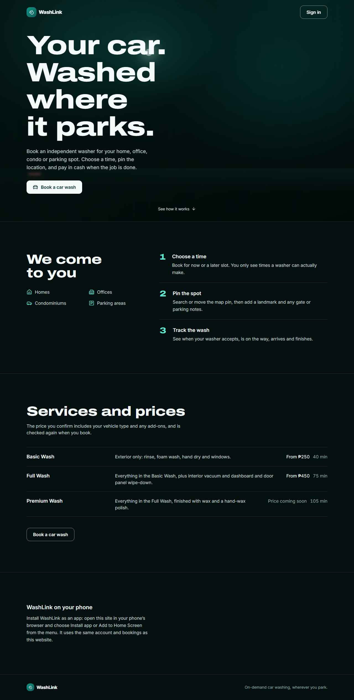

# 02 · Branding: name, logo, color, type and voice

> Documented 2026-11-10 from `main` at `4012ce7`.

## Name and logo
- **Name:** WashLink. Always one word, capital W and L. The wordmark sets **Wash** in ink and **Link** in brand teal
  (`text-[var(--color-brand-700)]`); on the dark landing page both halves are light.
- **Mark** (`frontend/src/presentation/design/ui/BrandMark.tsx`): the lucide `Droplets` icon, white, on a rounded
  square (`--radius-control`) filled with a teal gradient from brand-600 to brand-800, with the card shadow.
  Sizes `sm`, `md`, `lg`; `showWordmark` adds the text.
- **App icons** (`frontend/public/`): `icon-192.png`, `icon-512.png` (also maskable) and `apple-touch-icon.png`, a
  white water drop with a shine stroke on solid `#0F766E`. Drawn for the installable app on 2026-11-08.
- **Favicon:** `favicon.svg` is still the default Vite logo, not the WashLink mark. A known gap.

## Color
Brand teal is the only brand color. Everything else is slate "ink" and semantic colors. Values are in
[04 · Design system](04-design-system.md).

| Role | Token | Hex | Where it shows |
|---|---|---|---|
| Brand (primary) | `--color-brand-700` | `#0F766E` | Primary buttons, active tab text, wordmark "Link", theme-color, app icon |
| Brand dark | `--color-brand-800` / `-950` | `#115E59` / `#042F2E` | Button hover, landing button text |
| Brand light | `--color-brand-50` / `-100` | `#F0FDFA` / `#CCFBF1` | Selected cards, avatar, landing buttons |
| Landing night | `--landing-night` | `#03100F` | Landing page background |
| Landing accent | `--landing-accent` | `#5EEAD4` | Landing highlights |
| Ink | `--color-ink-900` … `-100` | `#0F172A` … `#F1F5F9` | Text, borders, page background |

The signed-in app is **light only**. The public landing page is **dark only** (scoped in
`frontend/src/features/b2c/landing/landing.css`). Sign in / create account is light.

## Type
- **Inter** (400–800) for everything (`--font-sans`, fallback Segoe UI, system-ui).
- **Archivo**, width 125 and weight 800, only for landing headlines (`.wl-display`): very wide, heavy, tight
  leading (1.02), balanced wrapping. Example: "Your car. Washed where it parks."
- App headings are Inter bold (`text-2xl font-bold` for page titles, `text-lg font-semibold` for sections).

## Iconography
lucide-react throughout (used in 186 files): `Droplets` (brand), `Navigation`, `Phone`, `Bell`, `Search`,
`LocateFixed`, `Car`, `Tag`, `Sparkles`. Stroke icons, no emoji.

## Voice and tone
Plain, short, friendly and direct; second person; no jargon; always says what happens next and what something costs.
Prices are pesos with "pay in cash". Errors say what to do. Copy examples, quoted as shipped:

| Where | Copy |
|---|---|
| Landing hero | "Your car. Washed where it parks." |
| Landing footer | "On-demand car washing, wherever you park." |
| Sign-in hero | "Your car. Washed where it parks." / "Book a detail in seconds, track it live, and let a washer bring the shine to your driveway." |
| Sign-in benefits | "Car wash professionals, booked online" · "Upfront pricing" · "Realtime status from booking to sparkle" |
| How it works | "Choose a time" · "Pin the spot" · "Track the wash" |
| Booking card | "₱450, pay in cash · Reference WL-C622A9A9" |
| No washer | "No washer accepted in time. Search again, or cancel and pick another time." |
| Install | "Install WashLink as an app: tap the Share button in Safari, then Add to Home Screen." |
| Operator account | "This account is run by WashLink, so it needs no verification documents. You can accept, run and cancel bookings." |
| Paused washer | "WashLink has paused your account. Contact WashLink about this booking." |

## What must stay the same in a redesign
The name and wordmark split, the Droplets mark and teal gradient, brand-700 as the primary color and theme-color,
the app icons, Archivo 125/800 for the landing display type, the copy above, pesos and "pay in cash", and the
Manila-time date formats.
