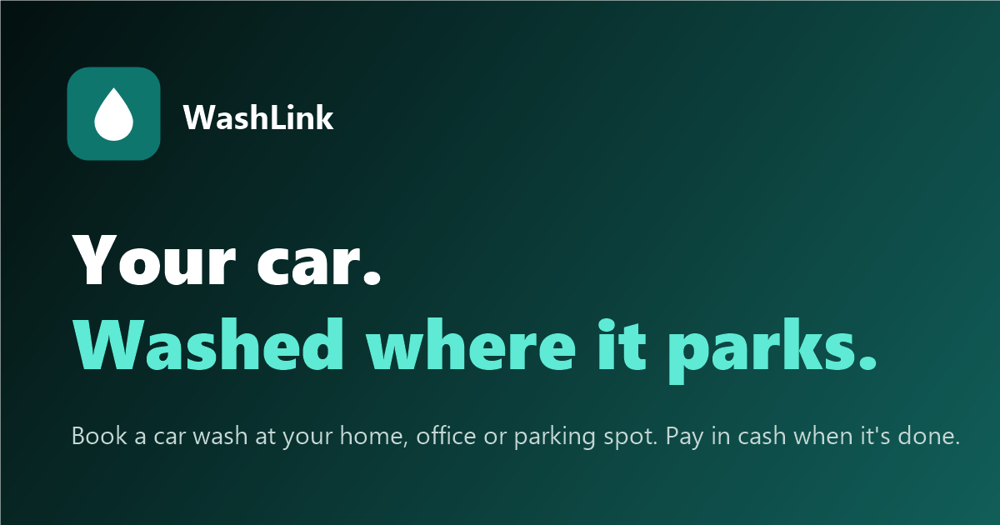

# 03 · SEO, metadata and the installable app

> Documented 2026-11-10 from `feature/ui-redesign` (Stage 4 added the search and sharing tags, robots.txt, sitemap,
> preview image and favicon). The live site gets them when this branch is deployed.

## `<head>` as served (`frontend/index.html`)
| Tag | Value |
|---|---|
| `<html lang>` | `en` |
| `<title>` | `WashLink — Book a car wash in minutes` |
| `viewport` | `width=device-width, initial-scale=1.0, viewport-fit=cover` |
| `theme-color` | `#0F766E` (brand-700); `#0A1315` while the dark theme is on |
| icon | `/favicon.svg`: the WashLink drop on a teal rounded square |
| `manifest` | `/manifest.webmanifest` |
| `apple-touch-icon` | `/apple-touch-icon.png` (180 px, white drop on teal) |
| `apple-mobile-web-app-capable`, `mobile-web-app-capable` | `yes` |
| `apple-mobile-web-app-title` | `WashLink` |
| `apple-mobile-web-app-status-bar-style` | `default` |
| Theme script | `/theme-init.js` (light or dark before paint) |
| `description` | "Book a car wash at your home, office, condo or parking spot in Metro Manila. Choose a time, pin the location, and pay in cash when the job is done." |
| `canonical` | `https://washlink-h7rc.onrender.com/` |
| Open Graph | `og:type` website, `og:site_name` WashLink, `og:locale` en_PH, `og:url`, `og:title` "WashLink — Your car. Washed where it parks.", `og:description`, `og:image` `/og-image.png` (1200×630, with alt text) |
| Twitter | `summary_large_image` card with the same title, description and image |
| Fonts | Google Fonts: Archivo (width 125, weight 800) and Inter 400–800, `display=swap` |

The page body is an empty `
`: everything, including the headline, is rendered by JavaScript. Search
engines that run JavaScript see the landing page; others see only the title.

## Manifest (`frontend/public/manifest.webmanifest`)
`name`/`short_name` WashLink · `description` "Book a car wash at your home, office or parking spot." · `start_url`,
`scope`, `id` `/` · `display` standalone · `orientation` portrait · `background_color` `#ffffff` · `theme_color`
`#0F766E` · icons `icon-192.png`, `icon-512.png` (also maskable).

## Service worker and offline
`sw.js` caches only `/offline.html` and serves it when a page navigation fails. It never caches the app or data.

Response headers as live (checked 2026-11-10). The live Render service was created by hand, not from the Blueprint, so
the headers and rewrite rule in `render.yaml` are **not** applied:

| Path | Headers |
|---|---|
| `/`, `/sw.js` | `cache-control: public, max-age=0, s-maxage=300`, HSTS, `x-content-type-options: nosniff` |
| `/manifest.webmanifest` | served as `binary/octet-stream` (should be `application/manifest+json`) |
| all | **no** Content-Security-Policy, X-Frame-Options, Referrer-Policy or Permissions-Policy |

## Crawling
- `public/robots.txt`: allow everything, `Sitemap: https://washlink-h7rc.onrender.com/sitemap.xml`.
- `public/sitemap.xml`: the single page `/`.
- **When WashLink gets its own domain**, change the address in `index.html` (canonical, `og:url`, `og:image`,
  `twitter:image`), `robots.txt` and `sitemap.xml` together.

## Remaining gaps
| Missing | Why it matters |
|---|---|
| Structured data (LocalBusiness / Service) | No rich results for the service area or prices |
| Server-rendered headline | Content only exists after JavaScript runs |
| Render response headers | The hand-made Render service doesn't apply `render.yaml` headers (CSP, `no-cache` for `sw.js`), and serves the manifest as `binary/octet-stream`; set them in the Render dashboard |

