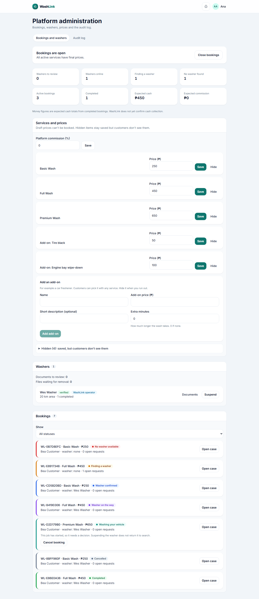

# Screen · Admin (Platform administration)

> Documented 2026-11-10 from `feature/ui-redesign` (stages 1–4), local stack with test data. Dark versions end in
> `-dark.png`. Screenshots:
> bookings and washers [phone](../screenshots/admin-bookings-and-washers-phone.png) · [desktop](../screenshots/admin-bookings-and-washers-desktop.png);
> booking case [phone](../screenshots/admin-booking-case-phone.png) · [desktop](../screenshots/admin-booking-case-desktop.png);
> audit log [phone](../screenshots/admin-audit-log-phone.png) · [desktop](../screenshots/admin-audit-log-desktop.png)

**Who sees it:** `super_admin`. **Files:** `frontend/src/features/superAdmin/SuperAdminDashboardPage.tsx`, tabs in
`frontend/src/presentation/components/superAdmin/superAdminTabs.ts`, `frontend/src/features/b2c/admin/`
(`B2cOperationsPanel.tsx`, `WasherVerificationCard.tsx`, `WorkerDocumentReview.tsx`, `AdminCancelBookingControl.tsx`,
`ReasonForm.tsx`, `addonKey.ts`).

## Frame
Top bar with the admin's name. Title "Platform administration", "Bookings, washers, prices and the audit log."
Tabs: **Bookings and washers** (default) and **Audit log** (B2B tabs appear only with B2B on). Everything is one
long scrolling page.

## Bookings and washers
1. **Open/closed card:** "Bookings are open / All active services have final prices." with **Close bookings** (or
   "Bookings are closed" with **Open bookings**; with drafts: "2 services still have draft prices. Set final prices
   below before opening.").
2. **Summary tiles** (8): Washers to review, Washers online, Finding a washer, No washer found, Active bookings,
   Completed, Expected cash, Expected commission; "Money figures are expected cash totals from completed bookings.
   WashLink does not yet confirm cash collection."
3. **Services and prices** (outlined section, "Draft prices can't be booked. Hidden items stay saved but customers
   don't see them."): Platform commission (%) with **Save**; then one card per **active** service and add-on: name, **Draft price** / **Hidden** badges, **Price (₱)**, **Save**
   (or **Set final price** for drafts) and **Hide**/**Show**. Then the **Add an add-on** card (Name, Add-on price
   (₱), Short description (optional), Extra minutes, **Add add-on**), and a collapsed **Hidden (n): saved, but
   customers don't see them** group holding hidden services and add-ons with **Show**.
4. **Washers** (outlined section with a count): "Documents to review: 0", "Files waiting for removal: 0"; one card per washer: name, **verified**
   badge, **WashLink operator** badge, "20 km area · 1 completed", **Documents**, **Suspend** (others: Verify,
   Reject, Move to pending, all with a reason).
5. **Bookings** (outlined section with a count): a **Show** select (All statuses or one status, by its friendly name,
   e.g. "Washer on the way"); one row per booking with a status-colored left edge: "WL-5102FAA1 · Basic Wash · ₱250"
   and a **status pill**, then "Bea Customer · washer: none · 0 open requests", **Open case**. Started jobs add "This job has started, so it needs a decision.
   Suspending the washer does not return it to search." and **Cancel booking** (reason ≥ 10 characters).
6. **Booking history** (after **Open case**, which then reads **Close case**): opens **directly under that row**, with
   timestamped changes in friendly words ("Tue, Nov 10, 9:00 PM: New to Booking received by customer", "…: Finding a
   washer to No washer available by system")
   and "Dispatch attempts: 1".

## Audit log
A search form built for the workforce (B2B) product: a "Long-open disputes read often" panel ("No flagged
disputes"), filters Action starts with, Subject type, Subject id, About this account id, Done by account id, From,
To, and **Search the audit log** ("Choose filters and search. Nothing is read until you search."). Example hints
mention job openings and worker contracts.

## Notes
- Still open: the audit log copy is workforce-specific (bookings and prices aren't mentioned).
- Before the redesign statuses were plain text, hidden items sat between active ones and the case history opened at
  the bottom of the page (baseline `1687f86`).
