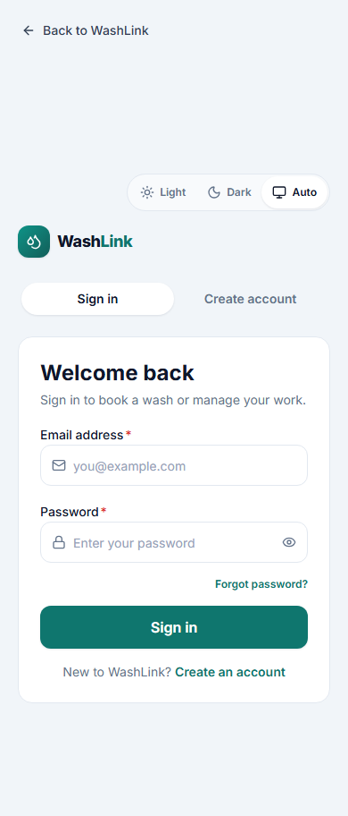
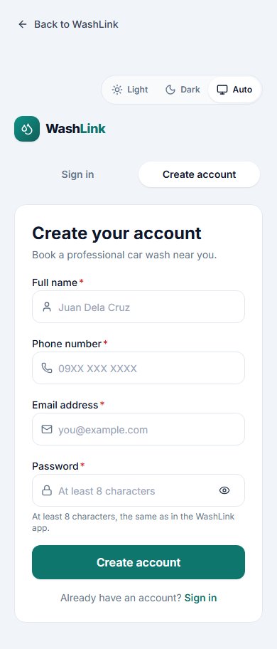
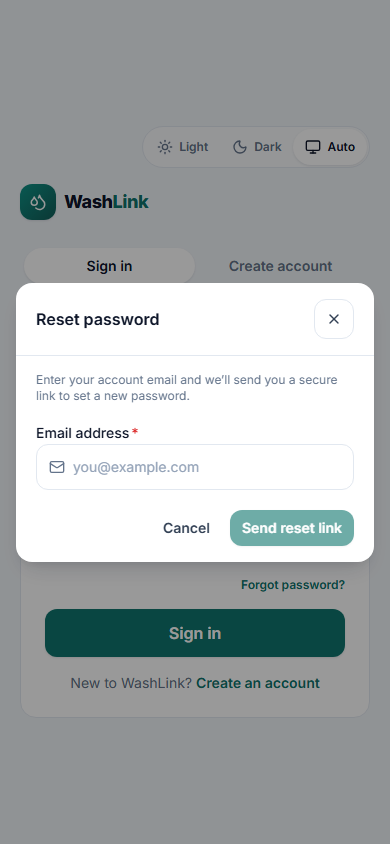

# Screen · Sign in, create account, forgot password, reset password

> Documented 2026-11-10 from `feature/ui-redesign` (stages 1–4), captured from the local build. Dark versions end in
> `-dark.png`. Screenshots:
> sign in [phone](../screenshots/auth-sign-in-phone.png) · [desktop](../screenshots/auth-sign-in-desktop.png);
> create account [phone](../screenshots/auth-create-account-phone.png) · [desktop](../screenshots/auth-create-account-desktop.png);
> forgot password [phone](../screenshots/auth-forgot-password-phone.png) · [desktop](../screenshots/auth-forgot-password-desktop.png)

**Who sees it:** signed-out visitors after tapping Sign in or Book a car wash. **Files:**
`frontend/src/features/auth/AuthLandingPage.tsx`, `AuthLandingForms.tsx`, `useAuthLanding.ts`, `RolePickerGrid.tsx`,
`SignUpFeedbackNotice.tsx`, `ResetPasswordPage.tsx`, `frontend/src/presentation/components/auth/ForgotPasswordModal.tsx`.

| Sign in | Create account | Forgot password |
|---|---|---|
|  |  |  |

## Look and feel
Light or dark. A **Light / Dark / Auto** switch sits at the top of the form column. On desktop a two-column layout: a teal gradient hero panel on the left and the form card on the right; on
phones only the form, with BrandMark above it. "← Back to WashLink" at the top left returns to the landing page.

- **Hero panel (desktop only):** pill "Shine in minutes", headline "Your car. Washed where it parks.", line "Book a
  detail in seconds, track it live, and let a washer bring the shine to your driveway.", three benefit rows with
  icons ("Car wash professionals, booked online", "Upfront pricing", "Realtime status from booking to sparkle"),
  footer "© 2026 WashLink. All rights reserved."
- **Tabs:** pill switcher **Sign in** / **Create account**.

## Sign in
Card titled "Welcome back", "Sign in to book a wash or manage your work." Fields **Email address**, **Password**
(show/hide eye), link **Forgot password?**, primary **Sign in**, footer "New to WashLink? **Create an account**".

## Create account
"Create your account", "Book a professional car wash near you." Fields **Full name** (placeholder "Juan Dela
Cruz"), **Phone number** ("09XX XXX XXXX"), **Email address**, **Password** ("At least 8 characters", helper "At least
8 characters, the same as in the WashLink app."), primary **Create account**, footer "Already have an account? **Sign in**".
No account-type picker while washer sign-up is closed; the account is always a customer. Duplicate emails show a
notice with **Sign in** and **Reset password** actions; email confirmation shows "check your email".

## Forgot password (modal)
"Reset password", "Enter your account email and we'll send you a secure link to set a new password." Field
**Email address**, buttons **Cancel** and **Send reset link** (disabled until an email is entered), close ×.

## Reset password page
Reached from the email link: fields **New password** and **Confirm new password**. Not captured (needs a real
recovery link).

## Notes
- Sign-up now requires 8 characters on the web, the same as the Expo app; sign-in still accepts older 6-character
  passwords.
- All required fields are marked with a red asterisk; errors appear under fields.
