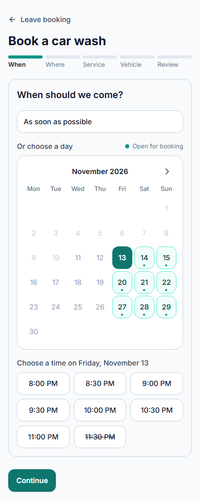
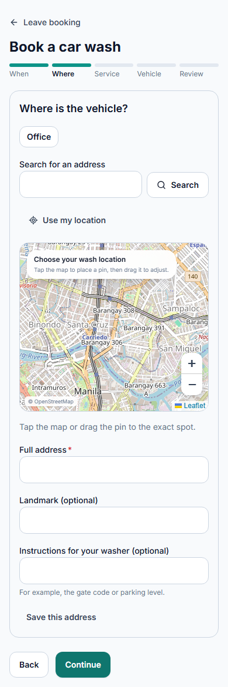
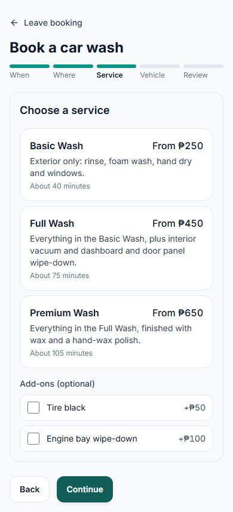
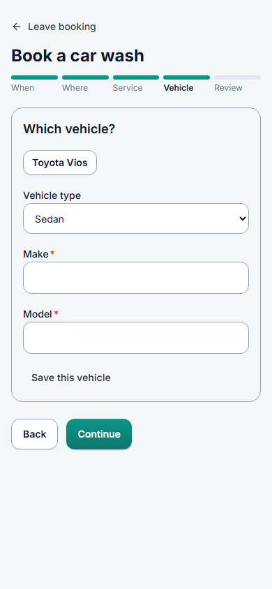
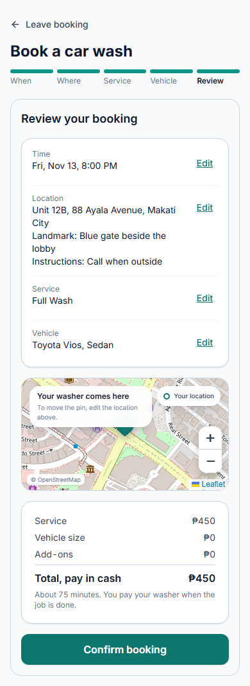

# Screen · Booking wizard

> Documented 2026-11-10 from `feature/ui-redesign` (stages 1–4), local stack with test data. Dark versions end in
> `-dark.png`. Screenshots (phone and desktop each):
> [1 When](../screenshots/wizard-1-when-phone.png) · [2 Where](../screenshots/wizard-2-where-phone.png) ·
> [3 Service](../screenshots/wizard-3-service-phone.png) · [4 Vehicle](../screenshots/wizard-4-vehicle-phone.png) ·
> [5 Review](../screenshots/wizard-5-review-phone.png); desktop versions end in `-desktop.png`.

**Who sees it:** customers, from **Book a car wash**. **Files:** `frontend/src/features/b2c/customer/wizard/`
(`BookingWizard.tsx`, `StepWhen.tsx`, `StepWhere.tsx`, `StepService.tsx`, `StepVehicle.tsx`, `StepReview.tsx`),
`packages/shared/src/bookingDraft.ts` (`bookingStepTitles`, `bookingStepProblem`), map
`frontend/src/presentation/components/shared/LocationPickerMap`.

| When | Where | Service | Vehicle | Review |
|---|---|---|---|---|
|  |  |  |  |  |

## Frame
Full screen, light or dark. "← Leave booking", title "Book a car wash", then a five-segment progress bar labelled
When, Where, Service, Vehicle, Review (done segments teal, current label bold). The current step sits in **one
outlined panel** under the bar. **Back** (outline) and **Continue**
(primary) at the bottom; each step is checked before moving on, and a repeated submit can't create a second booking.

## 1 · When: "When should we come?"
**As soon as possible** option, then "Or choose a day": a Monday-first month calendar of the next four weeks
(`BOOKING_CALENDAR_DAYS` = 28, one `availableSlots` call per day) with a "● Open for booking" legend and ‹ › when the
four weeks cross into the next month. Days with at least one free time are teal with a dot and can be picked; closed
days are grey and disabled. The first open day is selected for the customer (solid teal). Below, "Choose a time on
Friday, November 13": a 3-column grid of 30-minute slots. Only slots a washer can make are enabled; unavailable ones
are struck through (e.g. "11:30 PM" when the wash would run past the washer's hours). If no day is open: "No open days
in the next four weeks".

## 2 · Where: "Where is the vehicle?"
Saved places as chips ("Office"); **Search for an address** with **Search**; **Use my location**; an OpenStreetMap
map ("Choose your wash location — Tap the map to place a pin, then drag it to adjust."); "Tap the map or drag the
pin to the exact spot."; **Full address** (required), **Landmark (optional)**, **Instructions for your washer
(optional)** ("For example, the gate code or parking level."); **Save this address**.

## 3 · Service: "Choose a service"
One card per active service: name, "From ₱450" (or "Price not set" for drafts), description, "About 75 minutes".
The selected card is highlighted. **Add-ons (optional)**: checkboxes with "+₱50". Live: Basic, Full, Premium;
add-ons Tire black, Engine bay wipe-down.

## 4 · Vehicle: "Which vehicle?"
Saved vehicles as chips ("Toyota Vios"), **Vehicle type** select, **Make**, **Model** (required), and a save option.

## 5 · Review: "Review your booking"
A summary card with Time, Location (with landmark and instructions), Service and Vehicle rows, each with **Edit**;
a map "Your washer comes here"; a price card from the server (Service ₱450, Vehicle size ₱0, Add-ons ₱0,
**Total, pay in cash ₱450**, "About 75 minutes. You pay your washer when the job is done."); full-width
**Confirm booking**.

## Notes
- The three wash tiers are plain cards that differ only in text; wash types stay neutral by the owner's choice.
