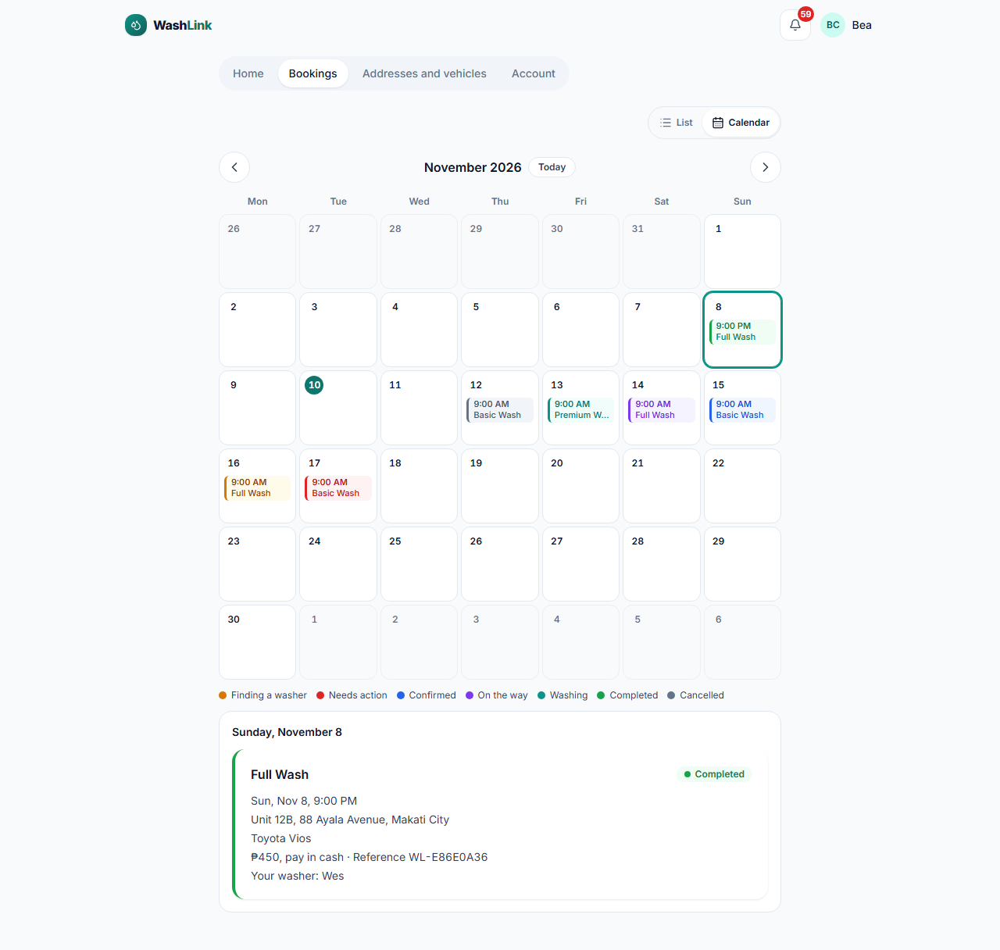

# Screen · Customer home

> Documented 2026-11-10 from `feature/ui-redesign` (stages 1–4), local stack with test data. Dark versions end in
> `-dark.png`; calendar: [phone](../screenshots/customer-bookings-calendar-phone.png) ·
> [desktop](../screenshots/customer-bookings-calendar-desktop.png). Screenshots:
> home [phone](../screenshots/customer-home-phone.png) · [desktop](../screenshots/customer-home-desktop.png);
> bookings [phone](../screenshots/customer-bookings-phone.png) · [desktop](../screenshots/customer-bookings-desktop.png);
> addresses and vehicles [phone](../screenshots/customer-saved-details-phone.png) · [desktop](../screenshots/customer-saved-details-desktop.png);
> account [phone](../screenshots/customer-account-phone.png) · [desktop](../screenshots/customer-account-desktop.png)

**Who sees it:** any signed-in customer. **Files:** `frontend/src/presentation/components/calendar/` (MonthCalendar, ViewToggle), `frontend/src/features/b2c/customer/CustomerHomePage.tsx`,
`BookingCard.tsx`, `SavedDetailsPanel.tsx`, `vehicleCategoryOptions.ts`, `frontend/src/features/b2c/DeleteAccountSection.tsx`,
`frontend/src/presentation/components/AuthenticatedTopBar.tsx`.

| Home | Bookings | Addresses and vehicles | Account |
|---|---|---|---|
|  |  |  |  |

## Frame
Light or dark page (`surface-sunken`), `max-w-3xl` column. **Top bar:** BrandMark, a bell with an unread count (red
badge), and an avatar with initials that opens the account menu (role, **Sign out**; `UserAccountMenu.tsx`). **Tabs** (pill track): Home,
Bookings, Addresses and vehicles, Account, in one row that scrolls sideways on a narrow phone. The account menu holds the
**Appearance** switch (Light / Dark / Auto).

## Home
- Dark teal hero card: "Book a car wash", "A washer comes to your home, office, condo or parking spot.", white
  **Book a car wash** button (car icon), which opens the [booking wizard](booking-wizard.md) full-screen.
- **Current bookings** (outlined section with a count): every booking that isn't finished, as booking cards.

## Bookings
A **List / Calendar** switch (top right, remembered on the device; List is the default).

- **List:** outlined sections **Needs action** ("No washer accepted these in time."), **In progress** ("Your washer is
  on the way or washing."), **Upcoming** ("Booked and waiting for the day.") and **Past** ("Completed, cancelled and
  expired."), each with a count; empty sections are hidden; upcoming soonest first, past newest first.
- **Calendar:** a Monday-first month with ‹ › and **Today**; today circled, the selected day outlined; each day shows
  its bookings as status-colored pills (time, then service) on wider screens or dots on phones, "+N more" on busy
  days, and a legend. The selected day's bookings appear underneath as normal booking cards.

### Booking card (`BookingCard.tsx`)
Card with a **4px left edge in the status color**: service name (bold) and a **status pill** (colored dot and words) on the right; date and time ("Tue, Nov 17, 9:00 AM");
address; vehicle; "₱250, pay in cash · Reference WL-5102FAA1"; "Your washer: Wes" once assigned. Actions by state:

| Status | Pill color | Extra content and actions |
|---|---|---|
| No washer available | red (needs action) | "No washer accepted in time. Search again, or cancel and pick another time." **Search again**, **Cancel booking** |
| Finding a washer | amber | **Cancel booking** |
| Washer confirmed | blue | Your washer, **Cancel booking** |
| Washer on the way | violet | Your washer, **Cancel booking** |
| Washing your vehicle | teal | Your washer (cancel only once overdue) |
| Cancelled | grey | none |
| Completed | green | Rating form after completion (1–5 and comment) |

Cancel asks for confirmation first.

## Addresses and vehicles
- **Vehicles** (outlined section with a count): saved cars as cards ("Toyota Vios · Sedan") with a trash icon; an outlined, dashed **Add a vehicle** form under them: **Type**
  (Sedan, Hatchback, SUV, Pickup, MPV, Van, Other; motorcycle removed in `4012ce7`), **Make**, **Model**,
  **Add vehicle**.
- **Addresses** (outlined section, "Saved from the booking map with Save this address."): saved places ("**Office**: Unit 12B, 88 Ayala Avenue, Makati City") with a trash icon. New
  addresses are saved from the wizard's Where step, not here.

## Account
Only the **Delete account** card: a full explanation of what is removed and kept, the washer-photo removal queue,
and the shop-records exception, then a **Delete account** button (it asks for confirmation and a recent password
sign-in).

## Notes
- Before the redesign six of seven statuses shared one pale blue pill and Bookings was one ungrouped list (baseline
  `1687f86`).
