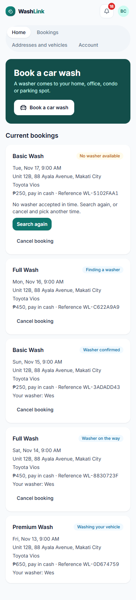
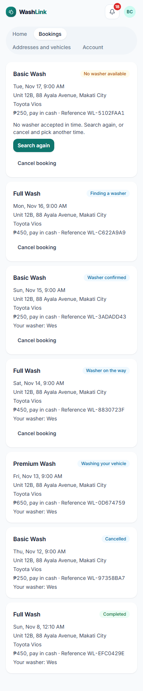
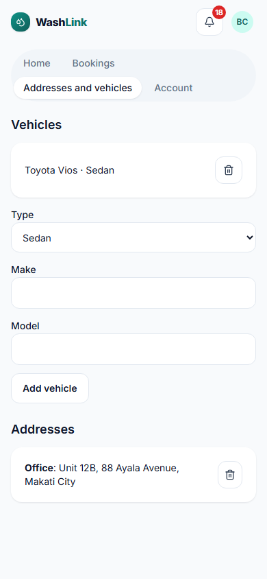
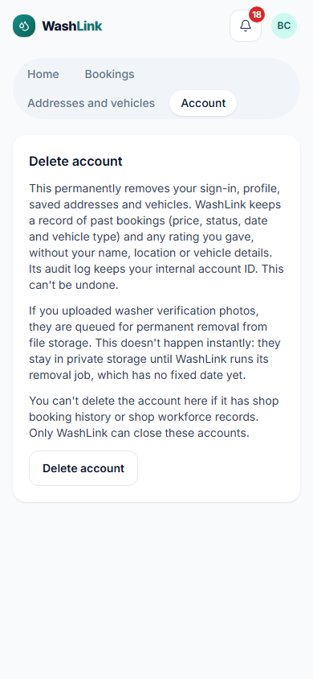

# Screen · Customer home

> Documented 2026-11-10 at `4012ce7`, local stack with test data. Screenshots:
> home [phone](../screenshots/customer-home-phone.png) · [desktop](../screenshots/customer-home-desktop.png);
> bookings [phone](../screenshots/customer-bookings-phone.png) · [desktop](../screenshots/customer-bookings-desktop.png);
> addresses and vehicles [phone](../screenshots/customer-saved-details-phone.png) · [desktop](../screenshots/customer-saved-details-desktop.png);
> account [phone](../screenshots/customer-account-phone.png) · [desktop](../screenshots/customer-account-desktop.png)

**Who sees it:** any signed-in customer. **Files:** `frontend/src/features/b2c/customer/CustomerHomePage.tsx`,
`BookingCard.tsx`, `SavedDetailsPanel.tsx`, `vehicleCategoryOptions.ts`, `frontend/src/features/b2c/DeleteAccountSection.tsx`,
`frontend/src/presentation/components/AuthenticatedTopBar.tsx`.

| Home | Bookings | Addresses and vehicles | Account |
|---|---|---|---|
|  |  |  |  |

## Frame
Light page (`surface-sunken`), `max-w-3xl` column. **Top bar:** BrandMark, a bell with an unread count (red
badge), and an avatar with initials that opens the account menu (role, **Sign out**; `UserAccountMenu.tsx`). **Tabs** (pill track): Home,
Bookings, Addresses and vehicles, Account. On a 390 px phone the four tabs wrap onto two rows.

## Home
- Dark teal hero card: "Book a car wash", "A washer comes to your home, office, condo or parking spot.", white
  **Book a car wash** button (car icon), which opens the [booking wizard](booking-wizard.md) full-screen.
- **Current bookings:** every booking that isn't finished, newest scheduled first, as booking cards.

## Bookings
All bookings, including finished ones, as the same cards in one long list, with no grouping by status or date.

### Booking card (`BookingCard.tsx`)
White raised card: service name (bold) and a **status pill** on the right; date and time ("Tue, Nov 17, 9:00 AM");
address; vehicle; "₱250, pay in cash · Reference WL-5102FAA1"; "Your washer: Wes" once assigned. Actions by state:

| Status | Pill color today | Extra content and actions |
|---|---|---|
| No washer available | amber (warning) | "No washer accepted in time. Search again, or cancel and pick another time." **Search again**, **Cancel booking** |
| Finding a washer | pale blue (info) | **Cancel booking** |
| Washer confirmed | pale blue | Your washer, **Cancel booking** |
| Washer on the way | pale blue | Your washer, **Cancel booking** |
| Washing your vehicle | pale blue | Your washer (cancel only once overdue) |
| Cancelled | pale blue | none |
| Completed | green (success) | Rating form after completion (1–5 and comment) |

Cancel asks for confirmation first.

## Addresses and vehicles
- **Vehicles:** saved cars as cards ("Toyota Vios · Sedan") with a trash icon; an add form under them: **Type**
  (Sedan, Hatchback, SUV, Pickup, MPV, Van, Other; motorcycle removed in `4012ce7`), **Make**, **Model**,
  **Add vehicle**.
- **Addresses:** saved places ("**Office**: Unit 12B, 88 Ayala Avenue, Makati City") with a trash icon. New
  addresses are saved from the wizard's Where step, not here.

## Account
Only the **Delete account** card: a full explanation of what is removed and kept, the washer-photo removal queue,
and the shop-records exception, then a **Delete account** button (it asks for confirmation and a recent password
sign-in).

## Notes for the redesign
- Statuses are hard to tell apart: six of seven use the same pale blue pill.
- Bookings has no "upcoming / in progress / past" grouping and no calendar.
- The form to add a vehicle sits directly under the list with no separation; sections aren't outlined.
