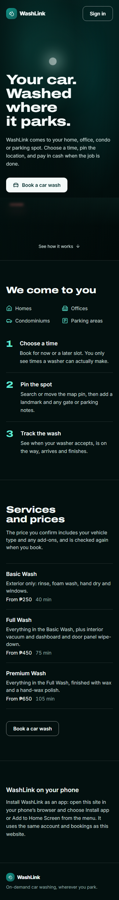

# Screen · Public landing page

> Documented 2026-11-10 from `feature/ui-redesign` (stages 1–4), captured from the local build. The landing page is
> dark in both themes. Screenshots:
> [phone](../screenshots/landing-phone.png) · [desktop](../screenshots/landing-desktop.png)

**Who sees it:** anyone signed out (B2C on). **Files:** `frontend/src/features/b2c/landing/PublicEntryPage.tsx`,
`PublicLandingPage.tsx`, `LandingHero.tsx`, `LandingHowItWorks.tsx`, `LandingServices.tsx`,
`LandingWasherAndApp.tsx`, `landing.css`; install help `frontend/src/features/install/useInstallPrompt.ts`.

## Look and feel
Dark, near-black teal background (`--landing-night`) with a soft glow behind the hero, very wide heavy Archivo
headlines, light text, thin white dividers. Calm and premium; one primary white button style and one outline style.
It's the only dark screen in the product.

## Sections, top to bottom
1. **Header:** BrandMark with wordmark (left), **Sign in** outline button (right). A skip link "Skip to main content"
   appears on keyboard focus.
2. **Hero:** `h1` "Your car. Washed where it parks." Sub-line "WashLink comes to your home, office, condo or parking
   spot. Choose a time, pin the location, and pay in cash when the job is done." Primary
   **Book a car wash** button (car icon). "See how it works ↓" link.
3. **We come to you:** four places with icons: Homes, Offices, Condominiums, Parking areas. Then three numbered steps
   with large accent numerals: **Choose a time** ("Book for now or a later slot. You only see times a washer can
   actually make."), **Pin the spot** ("Search or move the map pin, then add a landmark and any gate or parking
   notes."), **Track the wash** ("See when your washer accepts, is on the way, arrives and finishes.").
4. **Services and prices:** "The price you confirm includes your vehicle type and any add-ons, and is checked again
   when you book." Live list from the catalog: name, description, "From ₱250", duration. Live on 2026-11-10:
   Basic Wash (₱250, 40 min), Full Wash (₱450, 75 min), Premium Wash ("Price coming soon", 105 min). A second
   **Book a car wash** button. Empty state: "Services will be listed here soon."
5. **WashLink on your phone:** install help that adapts. Android Chrome shows an **Install the app** button;
   iPhone says Share → Add to Home Screen; others say use the browser menu; inside the installed app it says "You
   are using the WashLink app." The "Sign up as a washer" half is hidden while washer sign-up is closed.
6. **Footer:** BrandMark and "On-demand car washing, wherever you park."

Both **Book a car wash** buttons and **Sign in** open the sign-in screen ([auth](auth.md)); "Back to WashLink"
returns here.

## Notes
- The hero no longer says "independent washer" (changed in Stage 4).
- Draft prices read "Price coming soon"; the three washes look alike apart from text (wash types stay neutral).
