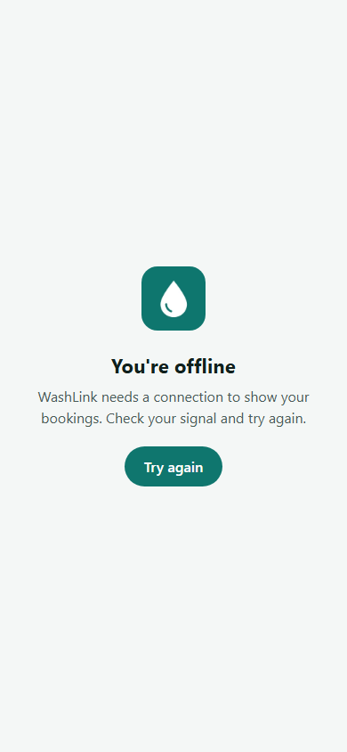

# Screen · Other screens (offline, owner paused, setup missing)

> Documented 2026-11-10 at `4012ce7`. Screenshots: offline [phone](../screenshots/offline-page-phone.png) ·
> [desktop](../screenshots/offline-page-desktop.png)

## Offline page
**File:** `frontend/public/offline.html`, served by `sw.js` when a page can't load. Plain HTML with inline styles
(no app code): the app icon, "You're offline", "WashLink needs a connection to show your bookings. Check your
signal and try again." and a pill **Try again** link back to `/`. Light background `#f4f7f6`, teal button.

## Shop owner paused
**File:** `frontend/src/features/auth/OwnerAccountPausedScreen.tsx`. Shown to `owner` accounts while B2B is off:
"Shop accounts are paused" and "WashLink now sends independent washers to customers. Your shop, bookings and
workforce records are kept and will be here if shop accounts return. For help, contact WashLink support." Not captured: no owner accounts remain on the live site.

## Supabase settings missing
Inline in `frontend/src/App.tsx`: "WashLink needs Supabase settings" with the missing variable names. Only appears
when a build has no Supabase URL or key; never on the live site.

## Loading and errors
A centered spinner (`PageLoadingFallback`) while sign-in state or a page loads; an `ErrorBoundary` catches crashes;
toasts (`sonner`) confirm actions ("Welcome back!", "Price saved") and show refusals from the database in plain
words.
