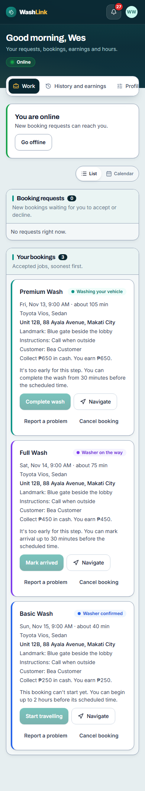
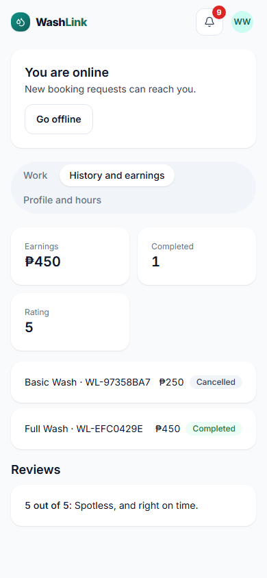
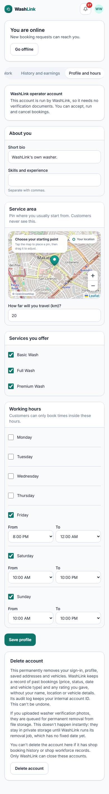
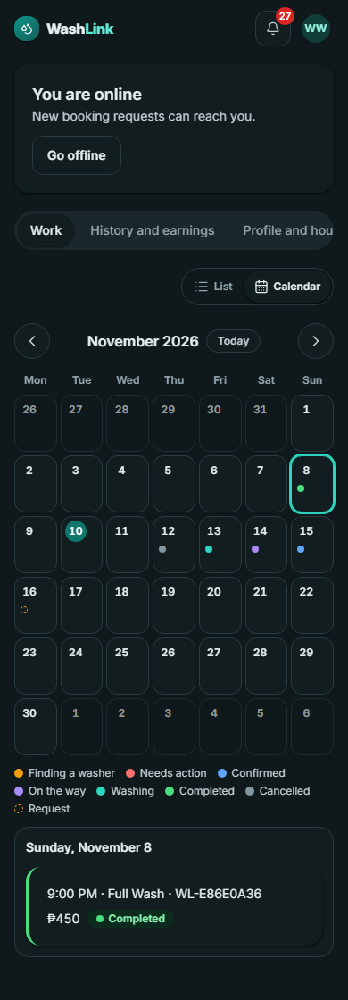

# Screen · Washer (operator)

> Documented 2026-11-10 from `feature/ui-redesign` (stages 1–4), local stack with test data. Dark versions end in
> `-dark.png`; calendar: [phone](../screenshots/washer-work-calendar-phone.png) ·
> [desktop](../screenshots/washer-work-calendar-desktop.png). Screenshots:
> work [phone](../screenshots/washer-work-phone.png) · [desktop](../screenshots/washer-work-desktop.png);
> history and earnings [phone](../screenshots/washer-history-phone.png) · [desktop](../screenshots/washer-history-desktop.png);
> profile and hours [phone](../screenshots/washer-profile-phone.png) · [desktop](../screenshots/washer-profile-desktop.png)

**Who sees it:** `worker` accounts; today that means WashLink's operator account. **Files:**
`frontend/src/features/b2c/worker/IndependentWorkerPage.tsx`, `RequestCard.tsx`, `AssignedJobCard.tsx`,
`WorkerSetupPanel.tsx`, `WorkerDocumentsPanel.tsx`; statuses and steps in `packages/shared/src/bookingStatus.ts`.

| Work | History and earnings | Profile and hours |
|---|---|---|
|  |  |  |

## Frame
Same top bar as customers. Above the tabs, an **online card**: "You are online / New booking requests can reach
you." with **Go offline**, or "You are offline" and the reason, with **Go online**. A paused account shows an
amber notice. Tabs: Work, History and earnings, Profile and hours, in one row that scrolls sideways on phones.

## Work
A **List / Calendar** switch (remembered on the device; List is the default). The calendar shows accepted and past
jobs in their status colors and open requests as dashed pills; choosing a day lists its requests and jobs with their
usual buttons, and finished jobs as short rows.

**Booking requests** (outlined section, "New bookings waiting for you to accept or decline."): offer cards with service, "You earn ₱450" in teal, "Sedan · Mon, Nov 16, 9:00 AM · about 75
min · Within 2 km", "Reference WL-C622A9A9 · expires in 40:40" (a live countdown), **Accept** and **Decline**. No
address is shown until accepted. Empty: "No requests right now."

**Your bookings** (outlined section, "Accepted jobs, soonest first."): one card per accepted job, soonest first, with a
status-colored left edge: service, **status pill** (blue confirmed, violet on the way or arrived, teal washing), time and
duration, vehicle, **address in bold**, landmark, instructions, customer name, "Collect ₱250 in cash. You earn
₱250." The single next step is the primary button (**Start travelling**, **Mark arrived**, **Start wash**,
**Complete wash**), with **Navigate** (opens maps) and **Call customer** when a phone exists. If it's too early,
the button is pale and a line explains, worded for the step ("This booking can't start yet. You can begin up to 2 hours
before its scheduled time.", "…You can mark arrival…", "…You can start the wash…", "…You can complete the wash from
30 minutes before the scheduled time."). Below: **Report a problem** and **Cancel booking** (operator; other washers see "I can't do
this booking"), which open a reason field (10–500 characters).

## History and earnings
Three stat cards (Earnings, Completed, Rating), then outlined **Past bookings** (rows with a status edge and pill:
Completed green, Cancelled or Expired grey) and **Reviews** ("5 out of 5: Spotless, and right on time.").

## Profile and hours
1. **WashLink operator account** card: "This account is run by WashLink, so it needs no verification documents.
   You can accept, run and cancel bookings." (Other washers see the verification photos panel here.)
2. **About you:** Short bio, Skills and experience ("Separate with commas.").
3. **Service area:** "Pin where you usually start from. Customers never see this." map, "How far will you travel
   (km)?"
4. **Services you offer:** a checkbox per active service.
5. **Working hours** ("Customers can only book times inside these hours."): Monday to Sunday, each with a checkbox
   and From / To side by side, in 12-hour times ("10:00 AM", "8:00 PM"); To goes up to "12:00 AM" (midnight). The
   live operator schedule: Friday 8:00 PM to 12:00 AM, Saturday and Sunday 10:00 AM to 10:00 PM.
6. **Save profile**, then the **Delete account** card.

Items 2–5 are outlined sections.

## Notes
- Before the redesign every job pill was the same blue, the arrival message showed above Complete wash, working hours
  broke on phones and there was no calendar (baseline `1687f86`).
