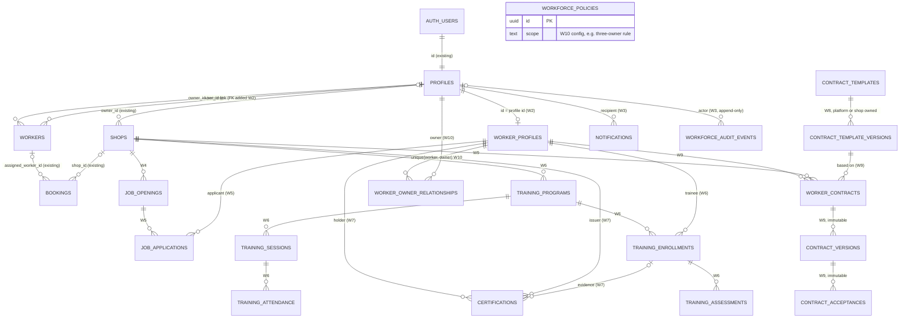

# WashLink Workforce Module - Architecture Audit (W0)

Branch `feature/workforce` from `main` @ ec6570a. Audit date 2026-10-24. Read-only investigation:
no code, migration or database was changed, and no Supabase project (linked or local) was
contacted. Line numbers are 1-based and refer to the files as they are at ec6570a.

## Top summary for the human (read first)

| ID | Severity | Status | Finding | Routed to |
|---|---|---|---|---|
| **E1** | HIGH | **UNVERIFIED against production** | Signup role comes from client-controlled `auth.signUp` metadata; any caller can request `role: 'super_admin'` unless the (not-in-repo) signup trigger whitelists roles. | W2, test `j17_signup_cannot_self_assign_super_admin` |
| **E2** | HIGH | **UNVERIFIED against production** | If `profiles` has an unrestricted self-update policy, a user can `update profiles set role = 'super_admin'` on their own row; `is_super_admin()` then grants full admin. No trigger in the repo prevents it. | W2, test `j17_profile_owner_cannot_change_role` |
| E3 | MEDIUM | Verified from repo | Any authenticated user can INSERT a shop already `verification_status = 'approved'`. | W2, test `j17_owner_cannot_insert_preapproved_shop` |
| F5 | Bug | Verified from repo | Owner resubmission after `changes_requested` is blocked by the verification trigger. | W1 test / W2 fix, `j18_owner_can_resubmit_after_changes_requested` |

E1 and E2 depend on objects that exist only on the linked project (signup trigger, `profiles` RLS).
They may be live in production today. The loop must NOT probe production to confirm; a human
should check them (see D-8, D-10 in `loop/workforce/DECISIONS.md`).

## Migration inventory (F1)

`supabase/migrations/` contains five files and no `CREATE TABLE` for `profiles`, `bookings` or
`workers`:

| File | Creates | Alters |
|---|---|---|
| `2026_04_17_add_shops_and_booking_location.sql` | `shops` (9-19), 4 shops policies (27-51) | `bookings` + shop_id, latitude, longitude (56-59) |
| `2026_04_18_super_admin_and_shop_verification.sql` | `is_super_admin()` (83-95), `prevent_owner_verification_mutation()` + trigger (125-150), `shop_verification_documents` (155-174), bucket (240-242) | `profiles` role CHECK rewrite only if a role CHECK exists (10-53); `shops` verification columns (58-75) |
| `2026_10_21_shop_pricing_and_booking_quotes.sql` | `shop_pricing` (4-18), `set_shop_pricing_updated_at()` (83-97), `set_booking_quote_from_shop_pricing()` + BEFORE INSERT trigger (138-174) | `bookings` + quoted_price (135-136) |
| `2026_10_22_add_booking_notes_and_ratings.sql` | - | `bookings` + customer_notes, customer_rating_* and stars CHECK (5-26) |
| `2026_10_22_fix_shop_verification_storage_rls.sql` | `can_manage_shop_verification_storage(text)` (4-19) | replaces the 4 storage.objects policies (26-77) |

- `profiles` is only referenced (FKs in shops / shop_verification_documents, `is_super_admin()`).
- `workers` is never referenced by any migration.
- There is no `supabase/config.toml`; only untracked `supabase/.temp/cli-latest`. W1 must run
  `supabase init` locally.
- `README.md:56-58`: migrations were applied to the linked project by hand in the SQL Editor,
  in filename order. So the linked project's real schema is unknown to the repo (D-1, D-10).

## Reconstructed schema

Every column is labelled **from migration** (DDL in `supabase/migrations/`) or **inferred**
(derived from frontend selects/inserts, `backend/app/models/*.py`, or
`backend/migrations/versions/0001_create_initial_schema.py`). The backend/Alembic scaffold drifts
from Supabase (e.g. backend `bookings.scheduled_at` vs frontend `bookings.time`); where they
disagree, frontend usage wins because it is what runs against Supabase.

### profiles (no CREATE in repo)

| Column | Type | Source | Evidence |
|---|---|---|---|
| id | uuid PK, = auth.users.id | inferred | `SupabaseAuthRepository.ts:150-153` (`.eq('id', user.id)`); backend `profile.py:13` |
| role | text or enum: customer, owner, worker, super_admin | inferred (constraint unknown) | select at `SupabaseAuthRepository.ts:152`; 2026_04_18:10-53 rewrites a role CHECK only IF one exists, so if none existed the column may be unconstrained |
| full_name | text | inferred | `SupabaseAuthRepository.ts:152`; updated in `SupabaseProfileRepository.ts:39-45` |
| phone_number | text | inferred | same as full_name |
| created_at | timestamptz | inferred | backend `profile.py:17` only |
| updated_at | timestamptz | inferred | backend `profile.py:18` only |

Profile creation: `SupabaseAuthRepository.ts:22-33` calls `auth.signUp` with
`options.data = { role, full_name, phone_number }` and never inserts into `profiles`. Therefore an
`auth.users` trigger (name unknown, conventionally `handle_new_user`) must copy
`raw_user_meta_data` including the **client-controlled** `role` into `profiles`. It is not in the
repo (inferred).

### bookings (no CREATE in repo)

Select list: `supabaseBookingRow.ts:24-25`.

| Column | Type | Source |
|---|---|---|
| id | uuid PK | inferred |
| customer_name | text | inferred |
| customer_id | uuid (-> profiles.id) | inferred |
| vehicle_type | text | inferred |
| service_type | text | inferred |
| address | text | inferred |
| time | timestamptz / text | inferred (backend calls it `scheduled_at`) |
| booking_status | text: pending, accepted, in_progress, completed, rejected, cancelled | inferred (values from `supabaseBookingRow.ts:3-10`; DB constraint unknown) |
| created_at | timestamptz | inferred |
| assigned_worker_id | uuid -> workers.id | inferred (backend `booking.py`, FK on DB unknown) |
| shop_id | uuid -> shops.id on delete set null | from migration (2026_04_17:57) |
| latitude, longitude | double precision | from migration (2026_04_17:58-59) |
| quoted_price | numeric(10,2), set by BEFORE INSERT trigger | from migration (2026_10_21:135-136, 170-174) |
| customer_notes | text | from migration (2026_10_22 notes:6) |
| customer_rating_stars | smallint, CHECK null or 1..5 | from migration (2026_10_22 notes:7, 11-26) |
| customer_rating_comment | text | from migration (2026_10_22 notes:8) |
| customer_rated_at | timestamptz | from migration (2026_10_22 notes:9) |

### workers (no CREATE in repo, never referenced by a migration)

| Column | Type | Source |
|---|---|---|
| id | uuid PK | inferred |
| owner_id | uuid -> profiles.id | inferred (`SupabaseWorkerRepository.ts:24,71`; backend `worker.py:32`) |
| user_id | uuid, nullable, no FK in scaffold | inferred (`SupabaseWorkerRepository.ts:53`; backend `worker.py:33`) |
| name | text | inferred |
| phone_number | text | inferred |
| is_available | boolean default true | inferred (`SupabaseWorkerRepository.ts:74,104`) |
| created_at, updated_at | timestamptz | inferred (backend `worker.py:37-38` only) |

### Migrated objects (all from migration)

- `shops`: id uuid PK, owner_id -> profiles.id on delete cascade, name, address, phone_number,
  latitude, longitude, is_active bool default true, created_at (2026_04_17:9-19);
  verification_status text not null default 'pending' with CHECK
  `shops_verification_status_check` in (pending, changes_requested, approved, rejected),
  verification_notes, verification_submitted_at, verification_reviewed_at,
  verification_reviewed_by -> profiles.id on delete set null (2026_04_18:58-78). No updated_at.
- `shop_verification_documents`: id, shop_id -> shops on delete cascade, document_type CHECK in
  (business_permit, dti_sec_registration, mayors_permit, valid_government_id), storage_path,
  file_name, file_size_bytes, content_type, uploaded_by -> profiles on delete set null,
  uploaded_at; unique (shop_id, document_type) (2026_04_18:155-177).
- `shop_pricing`: id, shop_id -> shops on delete cascade, vehicle_type CHECK (Sedan, SUV, Pickup),
  service_type CHECK (Basic Wash, Full Wash, Wax) default 'Basic Wash', price numeric(10,2) CHECK
  > 0, created_at, updated_at; unique (shop_id, vehicle_type, service_type) (2026_10_21:4-79).
- Storage bucket `shop-verification-documents`, private (2026_04_18:240-242).
- Functions:
  - `is_super_admin()`: SQL, stable, security definer, search_path public; true if the caller's
    `profiles.role = 'super_admin'` (2026_04_18:83-97).
  - `prevent_owner_verification_mutation()`: BEFORE UPDATE trigger on shops; non-admins may not
    change verification_status/notes/reviewed_at/reviewed_by (2026_04_18:125-150).
  - `set_booking_quote_from_shop_pricing()`: BEFORE INSERT on bookings; requires shop_id and an
    approved, active shop with a matching price; overwrites quoted_price (2026_10_21:138-174).
  - `can_manage_shop_verification_storage(text)`: security definer, true if caller owns the
    shop whose id is the first path folder (2026_10_22 fix:4-24).
  - `set_shop_pricing_updated_at()`: BEFORE UPDATE updated_at stamp (2026_10_21:83-97).

## RLS inventory

### Known (in repo)

| Table | Policy | Cmd | Predicate |
|---|---|---|---|
| shops | shops_select_active | SELECT | `(is_active and verification_status = 'approved') or owner_id = auth.uid() or is_super_admin()` (2026_04_18:105-113) |
| shops | shops_insert_own | INSERT | check `owner_id = auth.uid()` (2026_04_17:34-38) |
| shops | shops_update_own | UPDATE | using/check `owner_id = auth.uid()` (2026_04_17:40-45) + verification trigger |
| shops | shops_update_super_admin | UPDATE | using/check `is_super_admin()` (2026_04_18:115-120) |
| shops | shops_delete_own | DELETE | `owner_id = auth.uid()` (2026_04_17:47-51) |
| shop_verification_documents | svd_select_owner_or_admin | SELECT | admin or owns shop (2026_04_18:181-192) |
| shop_verification_documents | svd_insert_owner / svd_update_owner / svd_delete_owner | INSERT / UPDATE / DELETE | owns shop (2026_04_18:194-235) |
| shop_pricing | shop_pricing_select_available | SELECT | owns shop or admin or shop active+approved (2026_10_21:99-114) |
| shop_pricing | shop_pricing_owner_manage | ALL | owns shop (2026_10_21:116-133) |
| storage.objects | svd_storage_select_owner_or_admin | SELECT | bucket = shop-verification-documents and (admin or `can_manage_shop_verification_storage(foldername[1])`) (fix:26-38) |
| storage.objects | svd_storage_insert_owner / _update_owner / _delete_owner | INSERT / UPDATE / DELETE | bucket and `can_manage_shop_verification_storage(foldername[1])` (fix:40-77) |

All policies are `to authenticated`. No admin write policy on shop_verification_documents.

### Unknown (not in repo): profiles, bookings, workers

The frontend relies on RLS for scoping these tables, so their policies are security-critical:
- `SupabaseBookingRepository.fetchBookings()` (`SupabaseBookingRepository.ts:26-38`) selects ALL
  bookings with no filter (used by `BookingService.ts:14`).
- Realtime channel `bookings-realtime-channel` (`SupabaseBookingRepository.ts:198-225`)
  subscribes to every INSERT/UPDATE on bookings with no filter; exposure depends on RLS.
- `updateBookingStatus` (98-115) and `assignWorkerToBooking` (`SupabaseWorkerRepository.ts:117-126`)
  filter only by booking id; cancel (117-136), rating (138-168) and worker status updates
  (170-190) rely on client-side `.eq()` filters only. None of these filters is a control.
- `deleteWorker` (`SupabaseWorkerRepository.ts:87-96`), `updateWorkerAvailability` (98-115)
  and `fetchWorkerByIdentifier` (34-47) also filter only by id (W0 review S3).

## Privilege escalation

Spec A requires that owner/admin cannot be obtained via client-side data.

- **E1 (HIGH, UNVERIFIED against production).** `SupabaseAuthRepository.ts:22-33` sends `role` in
  signup metadata. `supabase.auth.signUp({ email, password, options: { data: { role: 'super_admin' } } })`
  yields a super_admin profile UNLESS the unknown signup trigger whitelists roles. The UI only
  offers customer/owner (`AuthLandingForms.tsx:306-319`); that is not a control.
  Route: W2. Test: `j17_signup_cannot_self_assign_super_admin`.
- **E2 (HIGH, UNVERIFIED against production).** The app updates its own profile by id
  (`SupabaseProfileRepository.ts:39-45`), so a self-update policy on profiles almost certainly
  exists. If it is not column-restricted, `update profiles set role = 'super_admin' where id = auth.uid()`
  succeeds and `is_super_admin()` (2026_04_18:83-95) then unlocks all shops, verification
  documents and the storage bucket. No trigger in the repo blocks role changes.
  Route: W2. Test: `j17_profile_owner_cannot_change_role`.
- **E3 (MEDIUM, verified from repo).** `shops_insert_own` (2026_04_17:34-38) checks only
  `owner_id = auth.uid()` (no role check), and the verification trigger is BEFORE UPDATE only
  (2026_04_18:146-150). Any authenticated user, including a customer, can INSERT a shop with
  `verification_status = 'approved'` (and forged reviewed_at/reviewed_by), add prices via
  `shop_pricing_owner_manage`, and become bookable through the quote trigger, bypassing admin
  review. Route: W2. Test: `j17_owner_cannot_insert_preapproved_shop`.
- **E4 (LOW, verified from repo).** Owners can still change `verification_submitted_at` and
  `is_active` on their shops (not covered by the trigger). Probably intended; recorded.
- **E5 (UNKNOWN).** Bookings UPDATE scope is unknown. The quote trigger is INSERT-only, so a
  customer may be able to change `quoted_price` or `booking_status` on their own rows depending
  on RLS. Route: W2. Test: `j17_customer_cannot_change_quoted_price`.

### F5. Existing bug: shop resubmission after changes requested (do NOT fix in W0)

`SupabaseShopVerificationRepository.ts:224-238` (`submitShopForVerification`) updates
`verification_status: 'pending'` for rows in `pending` or `changes_requested`. For a
`changes_requested` row this is a change of verification_status by a non-admin, which
`prevent_owner_verification_mutation()` (2026_04_18:135-141) rejects with "Only super admins can
change verification status or notes." So owners cannot resubmit after changes are requested
(resubmitting a still-`pending` shop works, since the value does not change).
Route: W1 regression test `j18_owner_can_resubmit_after_changes_requested` (expected to fail
first); W2 fix via a security-definer `submit_shop_for_verification(shop_id)`.

## Workers table

Current model (F6): an owner-managed roster row per (owner, person).
- Owners create rows without `user_id` (`SupabaseWorkerRepository.ts:64-77`).
- Worker-role users find their row by `user_id` with `.single()`
  (`SupabaseWorkerRepository.ts:49-54`, via `useWorkerProfileResolution.ts:30`). This breaks once
  a user is on two rosters, which is the expected case under spec F (multiple owners).
- Nothing in the frontend ever writes `user_id` (only read at line 53), and there is no worker
  self-signup (role picker is customer/owner only). How a worker account gets linked today is
  unknown (presumably by hand in SQL).
- `bookings.assigned_worker_id` points at the roster row, not the user.
- Realtime: `workers-updates-for-owner-<id>` filtered by owner_id (136-150).

Proposal (D-2 default, keep and link, no data migration):
1. Keep `workers` unchanged as the shop roster / booking-assignment entity.
2. New `worker_profiles` (PK = profiles.id) is the worker identity (W2).
3. `workers.user_id` is the link. W2 adds FK -> profiles.id and a partial unique index on
   (owner_id, user_id) where user_id is not null, and replaces the `.single()` lookup with a
   list or per-owner lookup.
4. Contracts and relationships reference `worker_profiles`, never roster rows. Roster rows may
   later be created from an active contract (W9/W10).

## Auth and email verification

- After signup the UI toasts "Account created. You can sign in now." (`useAuthLanding.ts:78`) and
  the app never reads `email_confirmed_at` (no match in `frontend/src`). This implies email
  confirmation is disabled on the linked project, or the message is misleading. Not verifiable
  without project config; the remote was NOT checked. W1's local `config.toml` sets the
  testable default.
- Password reset uses `resetPasswordForEmail` with `redirectTo` (`SupabaseAuthRepository.ts:115-117`,
  `ForgotPasswordModal.tsx:36`); this requires auth email/SMTP configured on the project.

## Notifications

- Only in-app `sonner` toasts (`presentation/design/ui/Toast.tsx:2`,
  `presentation/utilities/customerBookingStatusTransitions.ts`) driven by Supabase Realtime
  `postgres_changes` (bookings and workers channels above).
- No notifications table and no email sending from app code.
- `frontend/smtp-test.cjs` and `frontend/smtp-test.js` are tracked standalone nodemailer scripts
  reading `SMTP_*` variables from `process.env`; `nodemailer` is a frontend runtime dependency
  (`frontend/package.json:18`). Note only; not part of the app.
- Conclusion: W3 creates the `notifications` table; there is no existing system to reuse.

## Backend scaffold (F8)

FastAPI + SQLAlchemy/Alembic with SQLite fallback and its own profiles/shops/workers/bookings
models (`backend/app/models/`) that drift from Supabase (e.g. `booking.py` has `scheduled_at`,
`updated_at`, non-null `shop_id`). Confirms LOOP rule 2: no workforce tables in SQLAlchemy/Alembic.

## Proposed ERD

Conceptual; final columns are decided per increment. Existing tables are marked (existing).

| Table | Increment | RLS principle |
|---|---|---|
| worker_profiles | W2 | worker-own read/update (no role/verification columns); shop-owner read of applicants/contract parties; super_admin |
| notifications | W3 | recipient read / mark-read only; insert only via security-definer function |
| workforce_audit_events | W3 | append-only via security-definer function; super_admin read; no update/delete |
| job_openings | W4 | public read when open; shop-owner (verified shop) write |
| job_applications | W5 | worker-own; shop-owner of the opening; status only via function |
| training_programs / sessions / attendance / enrollments / assessments | W6 | shop-owner write; enrolled worker read own; transitions via function |
| certifications | W7 | holder + issuing shop read; issue/revoke via function; immutable decisions |
| contract_templates / contract_template_versions | W8 | super_admin (platform) or shop-owner; versions immutable |
| worker_contracts / contract_versions / contract_acceptances | W9 | the two parties + super_admin; versions and acceptances immutable; transitions via function |
| worker_owner_relationships / workforce_policies | W10 | parties read; write via function; policies super_admin |

## Findings routed to increments

| Finding | Target | Test / action |
|---|---|---|
| F1 core tables missing, no config.toml | W1 | `supabase init`; local-test-only baseline outside `supabase/migrations/` (D-1) |
| E1 signup role from metadata | W2 | `j17_signup_cannot_self_assign_super_admin` (D-8) |
| E2 role self-update | W2 | `j17_profile_owner_cannot_change_role` (D-8) |
| E3 pre-approved shop insert | W2 | `j17_owner_cannot_insert_preapproved_shop` |
| E4 owner edits submitted_at / is_active | W2 | record; decide if intended |
| E5 bookings update scope | W2 | `j17_customer_cannot_change_quoted_price` |
| F5 resubmission blocked | W1 test, W2 fix | `j18_owner_can_resubmit_after_changes_requested`; `submit_shop_for_verification(shop_id)` |
| F6 workers link / `.single()` | W2 | FK + partial unique (owner_id, user_id); list lookup (D-2) |
| Worker self-registration | W2 | add `worker` to role picker (D-9) |
| F7 email confirmation unknown | W1 | local `config.toml` default |
| F7 no notifications system | W3 | create `notifications` |
| Linked-project RLS/triggers unknown | standing gate | D-10: human schema dump + diff before any deploy |

Legal: W0 review raised flags W0-L1…L7 (`loop/workforce/increments/W0/LEGAL_FLAGS.md`).
These and later spec D/E/F items populate `docs/workforce/LEGAL_REVIEW_REGISTER.md` (created W13).
